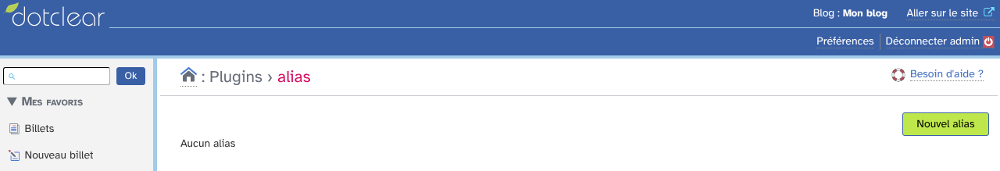
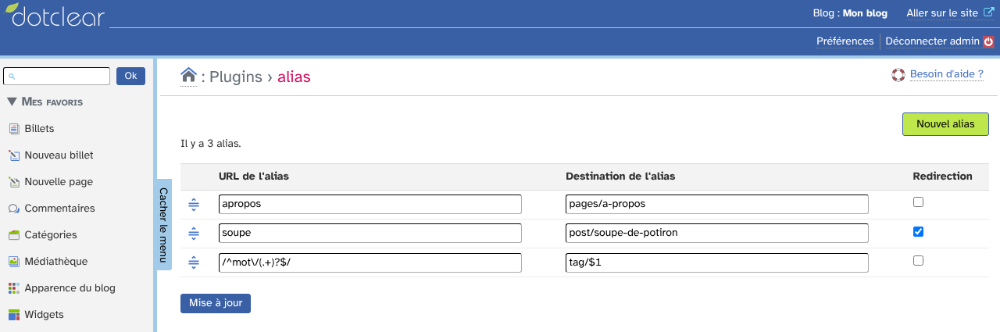
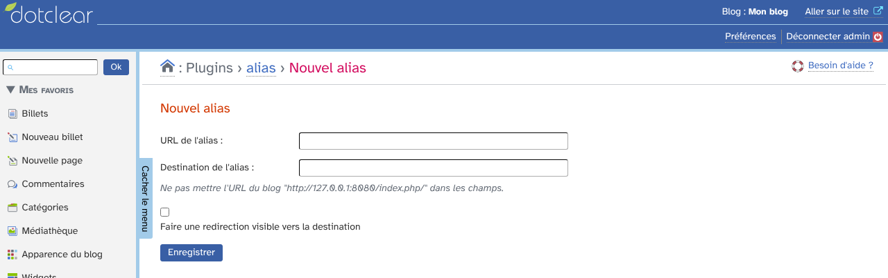
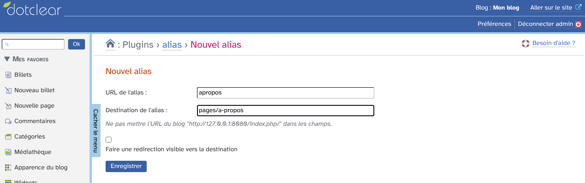

# alias : guide d'utilisation

Le plugin alias permet de créer des adresses (URL) de votre blog qui affichent le contenu d'une autre adresse : une page courte pour une page statique, un raccourci pour un billet, une ancienne adresse conservée après une refonte…

Le visiteur tape l'alias, et le blog sert la destination, sans créer de nouvelle page.

## Sommaire

* [Avant de commencer](#avant-de-commencer)
* [La liste des alias](#la-liste-des-alias)
* [Créer un alias](#créer-un-alias)
* [Exemples](#exemples)
* [Redirection visible ou non](#redirection-visible-ou-non)
* [Modifier, ordonner et supprimer](#modifier-ordonner-et-supprimer)
* [Bon à savoir](#bon-à-savoir)

## Avant de commencer

Les alias sont propres à chaque blog et se gèrent depuis le menu **alias** de la partie **Plugins** de l'administration.

Dans ce guide, une adresse s'écrit toujours **sans** l'adresse du blog : pour `http://monblog/a-propos`, l'alias est `a-propos`. Si vous collez une adresse complète, le plugin retire lui-même l'adresse du blog.

Les exemples utilisent un blog de test, « Mon blog », avec une page « À propos », un billet « Soupe de potiron » et des mots-clés.

## La liste des alias

La page du plugin liste les alias existants. Au début, elle est vide.

Le bouton vert **Nouvel alias** ouvre le formulaire de création.

Quand il y a des alias, chaque ligne affiche :

* l'**URL de l'alias** ;
* la **destination de l'alias** ;
* la case **Redirection**, cochée si la redirection est visible.

## Créer un alias

Cliquez sur **Nouvel alias**.

1. **URL de l'alias** : l'adresse que vous créez, par exemple `apropos` ;
2. **Destination de l'alias** : l'adresse qui doit s'afficher, par exemple `pages/a-propos` ;
3. cochez **Faire une redirection visible vers la destination** si besoin (voir plus bas) ;
4. cliquez sur **Enregistrer**.

Le nouvel alias apparaît à la fin de la liste. L'alias fonctionne tout de suite : `http://monblog/apropos` affiche la page « À propos ».

Deux alias ne peuvent pas avoir la même URL.

## Exemples

Les destinations sont les adresses habituelles de Dotclear :

| Pour afficher | Destination |
|---|---|
| une page statique | `pages/a-propos` |
| un billet | `post/soupe-de-potiron` |
| la page d'un mot-clé | `tag/recettes` |

Un alias peut aussi utiliser une **expression rationnelle**. Encadrez l'URL de l'alias par des `/` :

* URL de l'alias : `/^mot\/(.+)?$/`
* destination : `tag/$1`

Avec ce seul alias, `http://monblog/mot/recettes` affiche la page du mot-clé « recettes », `http://monblog/mot/balades` celle de « balades », etc. `$1` est remplacé par ce qui correspond à la première parenthèse de l'expression.

## Redirection visible ou non

* **Case décochée** : l'adresse de l'alias reste dans la barre d'adresse du navigateur, et le contenu de la destination s'affiche.
* **Case cochée** : le visiteur est redirigé vers la destination, dont l'adresse s'affiche. C'est préférable quand l'alias remplace une ancienne adresse : les moteurs de recherche et les favoris adoptent la nouvelle.

## Modifier, ordonner et supprimer

Depuis la liste, modifiez directement les champs puis cliquez sur **Mise à jour** : toutes les lignes sont enregistrées en une fois.

**Ordre.** Les alias sont testés dans l'ordre de la liste, et le premier qui correspond est utilisé. Glissez-déposez une ligne par la poignée à gauche pour la déplacer, puis cliquez sur **Mise à jour**. Placez les alias précis avant les expressions rationnelles.

Si le glisser-déposer est désactivé dans vos préférences d'accessibilité, un champ numérique permet de saisir la position de chaque ligne.

**Suppression.** Pour supprimer un alias, videz son URL ou sa destination, puis cliquez sur **Mise à jour**.

## Bon à savoir

* Le plugin charge tous les alias à chaque affichage d'une page du blog pour les tester : plus il y en a, plus le blog est ralenti. Gardez la liste courte.
* Les alias sont inclus dans l'export complet du blog et restaurés à son import, par le plugin Import / Export de Dotclear.
